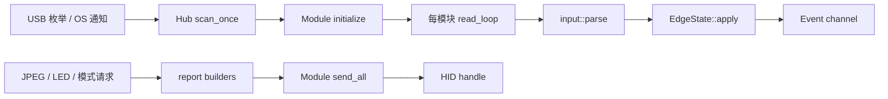

# 源码研究一：协议与设备

最后更新：2026-10-22。阅读基线 `0cbdde3`。本篇来自实际源码阅读；上游实验见[设备协议译文](设备协议.md)。没有运行硬件示例或 ignored test。

## 边界与调用链

`mh-protocol` 负责纯数据转换，`mh-device` 负责发现、打开、初始化、读写和生命周期。两者均不依赖 Tauri/React。开发专用应用可从 `Hub::start()`、`events()`、`modules()` 开始，复用现有状态机。

注意图中的启动会切换按键/dial 模式，不能把 `Hub::start()` 当作纯只读枚举。

## `mh-protocol` 逐模块

### `lib.rs`

[源码](../../crates/mh-protocol/src/lib.rs)。公开 descriptor、input、module、report、safety，重导出 Input/Orientation、ModuleKind/VENDOR_ID、Report/Query/LED 类型。没有初始化副作用。新上层功能应通过这些类型沟通，避免复制裸字节协议。

### `module.rs`

[源码](../../crates/mh-protocol/src/module.rs)。`ModuleKind` 是六类硬件的统一身份，维护 PID 双向映射、配置/API 名称、footprint、control_count、screen_size，以及 `needs_software_mode`、`is_m0`。Vendor 固定 `0x2516`；按键屏 480×272、dial 240×240；实体占格和按键排列不是同一个概念（Keys footprint 4×3，键阵列 5×3）。

扩展新硬件至少同步 PID/name/footprint/count/能力，再补解析与命令。现有测试覆盖 PID/名称往返、未知 PID、两套布局面积；面积测试不代表全部连接器几何已验证。

### `input.rs`

[源码](../../crates/mh-protocol/src/input.rs)。`parse(kind, raw)` 检查 input report id `0x01`，按 LE16 声明长度裁剪 payload，再匹配模块、tag 和事件头。无效短头返回空，未识别内容保留 `Input::Unknown {tag,payload}`，单个原始 report 可产生多个 Input。

- Keys/Faders 输出整组快照，而非按键边沿；Faders 长度足够后转换 `[u8;5]`，这里不把数值 clamp 到 100。
- Knobs 的 `0xFF` 表无变化，值 1 顺时针，其余非 FF 逆向；Rollers 的 0 向上，其余非 FF 向下；Dial 的 0 顺时针。
- Orientation 只区分字节 1 / 其他，不是四方向姿态。

测试使用抓取样本覆盖各模块、并发按键、未知 tag、空/非 input report。若未来固件改格式，应增加原始样本测试后改 parser，不要在 UI 猜方向。

### `descriptor.rs`

[源码](../../crates/mh-protocol/src/descriptor.rs)。这是最小 HID short-item 解析器，只追踪 Report ID、Count、Size，遇目标 Output 返回含 report id 的总字节数。截断通过 `get(..)?` 返回 None。它不是完整 HID descriptor interpreter，不维护全套 push/pop 或累加复杂字段。测试覆盖捕获的 keys 320 B、M0 64 B、未知 id、截断。新硬件 descriptor 复杂度必须重新核实。

### `report.rs`

[源码](../../crates/mh-protocol/src/report.rs)。`Report::Output` 对应 hid_write，`Feature` 对应 send_feature_report。builder 返回含 report id 的字节，padding 由 transport 做；不适用能力返回 None，非法按键图片索引返回空。

- `FEATURE_LEN=32`，图片 header 8 B，chunk payload=`output_len-8`，至少 1；chunk number 与 data length 为 LE16，最后块 last=1。按键单图 command 0x36，整图 0x35，dial 0x45。
- Base LED 的 group/index 强制 (0,0)，Faders group 1 / index 0–4，Knobs group 2 / index 0–2，All 为 FF，其他类型没有 LED builder。
- brightness/speed clamp 到最大 100；**backlight builder 仍允许 0**。避免 macOS 零亮度卡死由上层输出路径落实，复用低层时不能误以为 builder 已覆盖此约束。
- `persist` 可以要求颜色/模式跨掉电保存，常规动态效果应沿用上层 false；“不刷固件”不等于所有 builder 都没有持久写入能力。
- Query 按模块映射 firmware/serial/fader/backlight/info/orientation。一般 feature answer 是 `[id,len,payload]`，但 base orientation 长度字节为 0，必须用专用 `parse_orientation`。
- firmware payload 跳过四个前缀字节再作 ASCII，serial 去空字符，screen_size 从 payload 4..8 读两个 LE16。

测试覆盖 mode、LED 地址、图片分块再拼接、单块 last、抓包应答与空固件。空 JPEG 产生零 report，调用方负责有效图片、尺寸、编码，不在此层解码 JPEG。

### `safety.rs`

[源码](../../crates/mh-protocol/src/safety.rs)。按 `(report id,command byte)` denylist 拒绝刷固件、改序列号、工厂保存/恢复、flash 图片保存、倾斜传感器校准。`is_forbidden` 只看前两字节，短 report 不匹配。它是明确命令集合的限制，不是任意 raw report 的完整语义验证。

`Module::send_all` 再查一次，所以手造 Report 也经过限制。测试遍历 builder 结果不落 denylist，并直接检查禁止命令。源码引用 `docs/DEVICE-AUDIT.md`，公开快照中该文档缺失，不能把此引用当可用研究材料。

## `mh-device` 逐模块

### `lib.rs` 与 `events.rs`

[入口](../../crates/mh-device/src/lib.rs)、[事件](../../crates/mh-device/src/events.rs)。入口公开 Hub、Module、ModuleId、Event，统一错误为 HID、NotConnected、Forbidden、NoAnswer、HardwareMode、Unsupported。

`ModuleId = kind + serial`，跨重连保持稳定；OS path 用于实际连接去重。`EdgeState` 把 Keys 快照转 KeyDown/KeyUp，Faders 首次报全部位置、之后只报变化，KnobPress 去重，Orientation 去重；旋转直接转事件，DialPress 没有与 knobs 相同的持久 pressed 去重状态；Unknown 在事件层丢弃。上层若要观察未知协议，应在这里之前记录。

现有单元测试核对按键边沿和推杆首次/变化行为、旋钮按压去重。

### `hub.rs`

[源码](../../crates/mh-device/src/hub.rs)。Shared 持模块表、OS path 表、reader handles、stop flag 和无界事件 channel。`Hub::start` 启 mh-scan，并等待第一轮 scan；模块可能因初始化失败仍未准备好，不能据此断言全部硬件在线。

扫描不是文档所说始终每秒：Windows 用配置管理通知，设备变化后的 10 s 或 backoff 期间每秒；平时每 15 s 兜底。无通知支持的系统保持每秒。循环 50 ms 检查 flag，open/init 失败至少等 2 s。

`scan_once` 仅枚举 vendor，按 PID 识别，按 OS path 排除已开连接。Windows 尝试第二 output handle；初始化后查询可信 serial，解析 port path。macOS 对 M0 发 SET_IDLE；失败记 warning 不阻止连接。初始化首次 NoAnswer 发 Unresponsive，macOS 连续三次失败可 reenumerate，每类型最多每分钟一次。

每模块 reader 用 64-byte buffer，经 input parser 和 EdgeState 发 Event。read error 移除相同 Arc 的模块与 path，再发 Disconnected，避免旧 reader 删除后来重连的新对象。已结束 reader 从列表移除。

关闭通过 stop 防重复，先 join scanner，再 join readers，再 release 所有模块，并记录各阶段耗时。上层应停止自身输出后再关闭 Hub，不要在关闭期继续绘图。

### `module.rs`

[源码](../../crates/mh-device/src/module.rs)。封装 HidDevice，保存输出长度、USB 路径、FairMutex、Windows 第二 writer、released/software_mode 原子状态。

关键顺序：

1. 获取 report descriptor 推导输出长度，失败回退 64。
2. Keys/Dial 初始化先 software on，等 600 ms，再 software on，等 200 ms，才查 firmware。
3. 空 firmware 最多三轮；后续轮先 hardware off、等 500 ms；发送或读错误立即返回，不在失败发送后强行读取。
4. 非 software mode 拒绝 Keys/Dial feature read；M0 不受此限制。

`send_all` 在一次锁内发整张图所有块，防 reader 每块间插入 20 ms read slice。Windows 全为 Output 时走独立 writer，Feature/混合列表用主 device；每条按 output_len/FEATURE_LEN padding。released 后发送安静返回 Ok，而非报告“已关闭”。`release` 幂等，在 device 锁内设 released，再直接发 software off。

复用注意：Windows output 与 release 使用不同锁，跨线程关闭时“不得再输出”的完整时序仍要依赖应用层停止 worker；不能只依据注释认为两个 handle 自动互斥。静态阅读提示此点需专门复核，并未证明存在可复现故障。

### `location.rs`

[源码](../../crates/mh-device/src/location.rs)。Windows 从 HID interface path 转 instance id，经 CfgMgr32 找 USB parent 的 `DEVPKEY_Device_LocationPaths`，提取 `USB(n)`；macOS 从 `DevSrvsID` 找 IORegistry，向上最多八层读 locationID，每 nibble 解一层端口。非 Windows/macOS 返回 None。

`slot_in_base` 从 base path 去掉固定三层得到底座根，要求 module path 共享此前缀，剩余端口用 `-` 连接。只识别连接器，不在这里算屏幕几何。测试覆盖 Windows path、mac locationID、已测 slot、不同 USB 分支与过短底座路径。注释仍写 macOS 未实现，与实际代码不符。

### `notify.rs`、`recover.rs`、`reenumerate_macos.m`、`build.rs`

- [notify](../../crates/mh-device/src/notify.rs)：Windows `CM_Register_Notification` 监听所有 HID interface，callback 只置 AtomicBool。OnceLock 保存进程级 handle，不注销；其他平台 watch=false，回退轮询。
- [recover](../../crates/mh-device/src/recover.rs)：解析 macOS HID registry id，调用两个 C ABI helper，将 0/1/2/3/其他状态译为成功、HID 消失、无 USB parent、打不开、操作失败。Windows 的 reenumerate 返回错误，SET_IDLE 为 no-op，管理员 pnputil 放在 app 层。
- [Objective-C](../../crates/mh-device/src/reenumerate_macos.m)：IOKit 向上找 IOUSBHostDevice，非 capture 打开；resetWithError 重枚举，SET_IDLE 为 bmRequestType 0x21/bRequest 0x0A、interface 0、duration 0。释放 IOKit 对象，ARC 管理 Objective-C。
- [build](../../crates/mh-device/build.rs)：仅 macOS 用 cc 编译 helper、开 ARC，并链接 IOUSBHost/Foundation/IOKit。

## 示例与硬件测试逐文件

所有例子位于 [examples](../../crates/mh-device/examples/)，本轮仅阅读：

| 文件 | 研究/验证用途 | 实际副作用或限制 |
|---|---|---|
| `probe.rs` | 按模块列 serial、firmware、输出长度、screen/faders | 启动 Hub，会切屏幕模块 software mode，结束归还 |
| `demo.rs` | 彩色按键、dial 环、旋转/推杆值联动 LED，验证重连重绘 | 改图片与灯；默认 60 s；不是正式渲染 engine |
| `backlight.rs` | 屏幕 20→100 并读回 | 改亮度，先退出 HubDeck |
| `cycle.rs` | 重复 start/draw/close，默认 20 轮、间隔 1000 ms | 找重启卡死；每轮最多等 10 s，写黑图 |
| `handback.rs` | 有/无动画后交还，再重启 | 默认 4 轮、流图 3 s、gap 6 s；等 dial 最多 25 s |
| `framerate.rs` | 预编码 60 帧，仅测传输；单屏和双线程双屏 | 默认每项 4 s、quality 80；写图，不表示屏幕实际显示帧率 |
| `enumtime.rs` | vendor-filter 枚举十轮计时 | 不打开模块，测扫描开销 |
| `raw_query.rs` | 直接 hidapi 查询指定十六进制 feature id，尝试 32/33/64 长度 | 绕开 Module 状态机，software on 后只等 300 ms，与正式 600+200 ms 不同；供诊断，不能当稳定接入模板 |
| `reenumerate.rs` | macOS reset 后等新 path，计时最多 20 s | 真正 USB 重枚举，不是无副作用查看 |
| `rollers.rs` | raw report、keepalive、可选 output、mac ioreg power state | 可写 --send，先 denylist；默认 20 s，每 5 s 查电源；不代表正式 Hub 的 SET_IDLE 路径 |
| `tests/output_timing.rs` | 比较 interrupt write/control SET_REPORT | `#[ignore]`，手工 `--ignored --nocapture` 才执行；改变 base 色，control pipe 可能超时 |

## 二次开发落点与验收

赛车按钮盒输入应消费 Event，不重复解析 HID。自有仪表先生成 JPEG，再通过已有 report/send_all；整面板图的可视窗口校准仍由上层负责。新硬件/固件支持修改 ModuleKind、input/report 和原始样本测试，再实机验证初始化、转向、按下/释放、全行程、拔插、重启、异常退出后的归还。

协议层单元测试可不接设备运行；设备 examples、ignored test、OS恢复不属于文档验证。本轮没有编译或实机结论。
