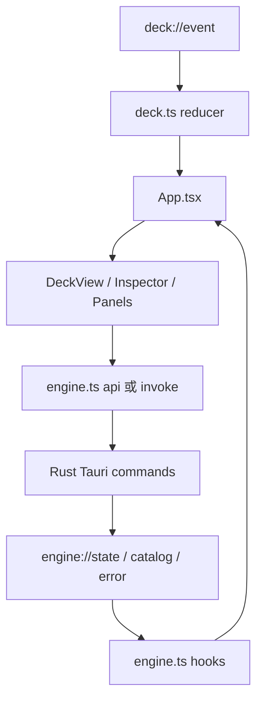

# 源码研究七：前端与编辑器

最后更新：2026-10-22。基线 `0cbdde3`。React/TypeScript 前端负责配置、预览和交互；设备 IO 与正式动作由 Rust 后端执行。

## 启动、状态和数据流

`main.tsx` 注册窗口 error/unhandledrejection 到 Rust 日志，使用 Recover Error Boundary 提供重新加载入口。性能探针每 5 秒汇总输入事件、mirror frame、窗口帧率及超过 50 ms 的帧；这反映窗口流畅度，不是 USB 延迟。普通浏览器且有 `?demo` 时先安装 mock，再渲染 App。

`App.tsx` 是页面编排中心：接入 useDeck、useEngine、placements、editing，管理选中 control、布局编辑、tour/builder、设置和侧栏。语言、reduced motion、插件文件打开队列、试用 preset 离开后的丢弃，都在顶层 effects 协调。硬件触摸通过 `startTransition` 延后重型 Inspector 更新，避免阻塞 fader 动画。

`deck.ts` 用 reducer 累积 snapshot、模块 attach/detach、按键、旋转与 fader 的即时状态；事件按窗口帧批量 dispatch，`lastTouched` 供自动选中。它不是 Profile store。`engine.ts` 镜像 Rust 的 Look/Binding/Profile/EngineState 等类型，提供 IPC api、动作能力判断、controlId 和订阅 hooks。修改 Rust serde 字段时需要同步这些类型；当前没有自动生成绑定。

## 实时预览为什么有两条路径

静态 `usePreview` 按 screen、previewSalt、Look JSON 缓存 Rust 渲染的 SVG；`inWindow` 加入字体 fallback。缓存是 Map，没有看到容量淘汰；后续高频编辑大量独特 Look 时可测量是否需要上限。

动态 keys/dial 走 Tauri Channel 的 JPEG mirror。`useLiveJpeg` 为帧建立 Blob object URL，约 1 秒后 revoke 上一帧，卸载时解绑并释放；不再把大量 base64 event 长期积累在 WebView。匹配 profile/page/module 后才显示，避免旧配置帧串入当前窗口。

在部分 WebKit 环境，用户最近 1200 ms 有输入时只留最新 pending frame，每 250 ms 检查；Windows Edge/WebView2 分支不等待。screensaver 则由 `saver.ts` 在窗口自行绘 SVG，不持续搬运设备 JPEG。修改效果时需同步 Rust `saver.rs`，测试固定随机数与动画差异。

## 布局与真实设备辨认

`layout.ts` 的网格为 4×6，FOOTPRINT 描述模块占格，`slots.generated.json` 提供自动 slot 布局。优先主人保存的位置，再用表，最后空位猜测；source/known 帮窗口说明依据。曾拥有但未接入的模块用 `kind@owned` 和 `detached:<kind>` 展示。

TypeScript Placement 的坐标是 number，允许 overhang；Rust 当前 col/row 为 u8，跨 IPC 持久化负坐标需单独验证。自动布局表不是“所有 slot 已经在实物验证”的证明；条目还带 verified 标记。

`identify.ts` 在安排布局时真正向硬件绘编号、dial 箭头以及 knob/fader 颜色；离开后清除并要求 Engine 重绘。它不只是窗口标记，UI 测试应避免无意在主人正在使用的设备上调用。

## 组件逐项说明

| 文件（`app/src/components/`） | 核心职责与阅读要点 |
|---|---|
| `DeckView.tsx` | 分层 SVG 描绘 base、keys、dial、knobs、faders、rollers；反映输入和 LED，处理布局拖动/旋转、动作拖入、key 交换、脱离模块和 control 菜单。Screen 给 inline SVG ID 加前缀避免 gradient/clip 冲突。key 拖动超过 6 px 才启动，只接受同模块另一个 key。 |
| `Inspector.tsx` | 选中 control 的 tap/hold/double、action params、look/lookOn、multi steps、modes、macro、live secret、weather、图片和 pet body 编辑。参数由目录里的 ParamDef 驱动并补专用字段。`useDebouncedSave` 默认 350 ms，保留 pending/flush，切换控件和收尾不能丢最后一次输入。 |
| `ActionChooser.tsx` | 搜索、分组、兼容输入筛选、常用/ideas/插件动作目录；支持 `application/x-hubdeck-action` 拖拽。界面过滤不能代替后端验证。 |
| `Panels.tsx` | 聚合 profile 列表/应用关联/置顶/试用，page 栏与可达性，灯光/屏幕，设置，集成连接，备份、语言、更新/回退，图库、插件文件安装、崩溃/权限/通话/无响应 banner。体积很大，今后可按独立设置领域拆分。 |
| `PluginsTab.tsx` | catalog 查询及安装，来源/当前系统/dial/tried/category 筛选、热度排序与分页，安装状态和 Use it。catalog 的 star/popularity 是数据快照，不能作为实时成熟度评估。 |
| `Assistant.tsx` | scan 同意选择、采访聊天、stream 事件、想法与草稿卡、试用比较、model/effort/context 信息、permission 卡片、taste 和 nudge。部分 store 在模块级，因此切换侧栏不会丢整段聊天。 |
| `Builder.tsx` | 逐控件选真实 option，创建工作 draft、即刻试用，最后保留/丢弃。用 Rust builder_options 取得设置，避免前端复制动作实现。 |
| `Tour.tsx` | 首次 desk check、用途选择、分站演示、外观选择、gesture 完成提示、音乐/屏保和收尾。订阅 `tour://gesture`；退出需要调用后端恢复，不只是隐藏页面。 |
| `Guide.tsx` | tour 后用遮罩高亮界面位置，测量目标框并定位说明卡，Esc/Skip/Done 收尾；已看过状态放 localStorage。 |
| `Calibration.tsx` | 共享 PanelGeometry 字段，启动/调整/保存/取消物理窗口校准；ComparePicker 卸载时清除 compare variant。窗口图形看起来正确仍需实物确认遮挡。 |
| `IconPicker.tsx` | 搜索内置图标、按需读游戏图标、安装/使用/移除 icon pack、导入图片。图标名和导入图片引用分别交给 Rust。 |
| `Icon.tsx` | 窗口界面图标的本地 SVG paths，hasIcon 和组件封装；与设备图片库有联系但不是所有设备图标的完整定义。 |

`Panels.tsx` 的主要设置边界值得单独记住：SwitchingSettings 控自动切换，LightsSettings 控全局灯，ScreensSettings 控 backlight/blank/saver，ProfilesFolder/Backups 管文件，Connections 管各服务，PluginsList 管已安装进程。修改一个设置时，应先找到对应 Rust command 和保存字段，不要只改 React state。

## 编辑动作与撤销

`editing.ts` 把复制/粘贴/清除/拖动交换统一到 binding 批量更新，一次包含 tap/hold/double。粘贴过滤不兼容输入，但不会凭空生成 missing action。history 最多 50 个 Profile 快照，同 profile 版本变化才加入，切 profile 清空；Ctrl+Z 通过保存前一个 Profile 撤销。它不是跨重启历史，也没有通用 redo。

键盘监听通过 ref 读取最新 view/selected/page，防止 stale closure 复制旧控件。输入框、textarea、select、contentEditable 继续使用原生编辑快捷键。双击 page key 会切页面；不执行其余任意绑定。

`confirm.ts` 是真正等待 Promise 的 Tauri confirm，失败返回 false。删除等不可逆窗口操作应复用它；过去 `window.confirm` 与异步插件混用造成误删的原因已有源码注释。

## 其余前端模块与数据

| 文件 | 作用 |
|---|---|
| `i18n.ts` | 英文基表、Polish 内置翻译、外部 LanguagePack、复数/变量替换/ReactNode、本地化 action/param/preset/game/error、模板导出。语言保存 localStorage，并同步后端。缺项回退英文；当前中文文档没有新增中文 UI。 |
| `locales/ja.json` | 内置 Japanese LanguagePack，按选择懒加载；大量文案数据，不包含动作执行代码。 |
| `theme.ts` | system/dark/light，localStorage 偏好与 `prefers-color-scheme`，应用 document data-theme，订阅外部 store。 |
| `styles.css` | 主题 tokens、三栏、面板、输入/按钮、助手/tour/builder、响应式和 reduced motion 等。灯色语义与可读性不能仅靠换一个背景 token 验证。 |
| `deck.css` | 设备舞台/比例、分层重绘、控件、LED 效果、拖拽、owned shelf；硬件本体颜色多数在 SVG，界面颜色用主题 token。 |
| `ideas.ts` | 常用非直播用途的静态动作建议，按 OS/语言处理；来源是上游某次社区调研，不是当前自动社区检索。 |
| `iconpacks.ts` | iconpacks_list/icons/use/import/remove 的类型化 IPC wrapper。 |
| `share.ts` | GalleryEntry 与图库/导入/诊断 wrapper，包后缀 `hubdeck`。 |
| `update.ts` | 更新查询、安装、回退、可用事件和版本 hooks；加载/解绑处理由 hook 管，下载验证在 Rust。 |
| `demo/params.ts` | 仅 `?demo` 时暴露截图参数，防止非 demo URL 误开启设计场景。 |
| `demo/index.ts` | mockIPC/mockWindows，处理模拟 API、状态、timer/tour/assistant/preview 等场景。主要服务设计和截图，未证明 mock 与后端永远一致。 |
| `demo/fixture.json` | 从 Rust ignored fixture 测试导出的真实目录、preset 和图片数据；动作变动后需要重新导出，不能长期手改当权威。 |
| `slots.generated.json` | `prototype/tools/gen_slots.py` 生成的 slot 布局输入，详见原型研究。 |
| `vite-env.d.ts` | Vite client 类型声明。 |
| `logic.test.ts` | 纯逻辑测试 control ID、输入能力、布局、page 可达性、彩虹与本地化等，无 Tauri 和 HID。 |
| `saver.test.ts` | 固定 u32 随机序列、效果可绘制和随时间变化；保持与 Rust 算法一致。 |

## 后续改造与验证

要新增一个 action，至少核对 Rust catalog/exec、前端 ParamDef 展示、输入兼容、语言文字、preview 和现有 preset。要新增遥测 panel，应优先复用 integration state 与共享 render，窗口 mirror 会自然取得硬件实际输出。

文档变更不需要启动设备来验证。本次只执行离线文档检查；以后改前端逻辑时可跑 `pnpm test` 和 TypeScript build，再用 browser demo 看布局，最后在 Tauri 和实物上验收。浏览器 demo 通过不能证明原生权限、文件对话框或硬件写入正常。
