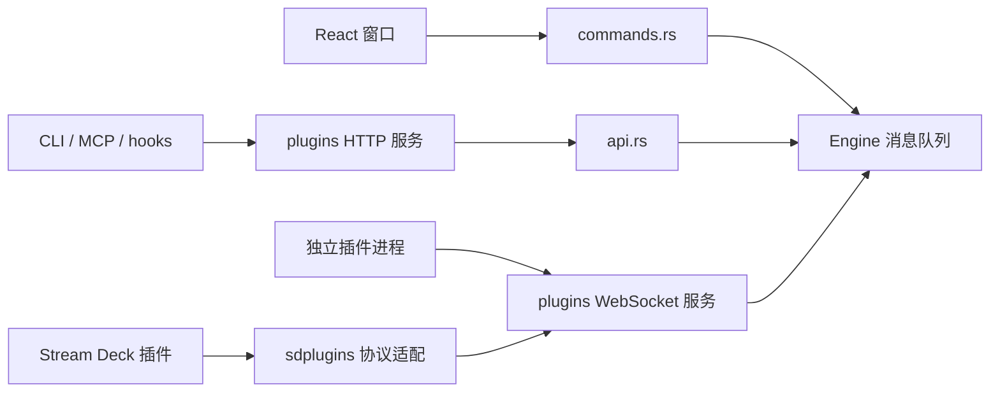

# 源码研究五：扩展接口与自动化

最后更新：2026-10-26。研究基线：`0cbdde3`；原研究为静态阅读，追加本 fork 的音频插件接口，具体运行验证见功能记录。

## 三层接口的关系

`commands.rs` 是 Tauri 窗口的 IPC；`api.rs` 是供脚本和模型使用的 HTTP 路由；`plugins.rs` 是插件进程及 WebSocket 宿主。它们最终都进入同一个 Engine，但验证路径并非完全相同。新增功能时，应明确哪些入口开放，避免只在窗口侧检查参数。

## `plugins.rs`：进程宿主与本地传输

启动时从数据目录的 `plugins/` 发现 manifest，把 action 定义接入动作目录。原生插件通过 `plugin/action` 标识动作，不是加载到 Rust 地址空间的动态库。

- WebSocket 和 HTTP 分别绑定 `127.0.0.1:0`，实际端口写入 `api-port`、`api-http-port`。`api-token` 至少 16 字符，缺失时生成 UUID token；各插件另有随机 token。
- HTTP 检查 `Authorization: Bearer <token>`，POST body 最多读 `16_000_000` 字节。首先调用 `api.rs`；剩余 `/api/<event>` 被作为异步 Engine 消息接收，返回 202 不等于动作已经成功执行。
- WebSocket 首条消息必须注册。原生插件和 `api` 使用 token；Stream Deck 的注册 UUID 对应宿主分配的 token。Property Inspector 还有独立的页面 UUID 关系。
- 一连接一线程，消息接收支持 UTF-8 Text/Binary frame，30 ms read timeout 让发送队列及时排空。`visible`、`titles` 缓存负责重连后补发 `willAppear` 和标题。
- Windows 尝试把进程放入带 `KILL_ON_JOB_CLOSE` 的 Job Object；加入失败记录日志。不能据此声称所有平台、所有子进程都被完整隔离。
- watchdog 每 2 秒检查退出，退出后至少 3 秒再启动，最多自动重启 5 次。手工 Stop 加入 `held`，不会被 watchdog 立刻拉起。

`input` 把 Press/Turn/Slide 变为插件事件；`swapped_input` 为旋钮“按住转/普通转交换”补齐 down、turn、up 顺序。修改这里必须覆盖释放事件，否则插件可能保持按下状态。

## `api.rs`：资源路由和数据验证

路由覆盖 catalog/modules/apps/games、profiles 与 pages、lights/leds、pictures/animations、连接应用的 states、assistant、notify/status/ask、controls 和 quit。自动化模式才开放 `/api/test/input` 与 `/api/test/foreground`。

`check_binding` 检查 control ID、动作是否存在、输入能力、hotkey、Select 参数、图标、颜色、style、LED effect 和已存图片。`check_profile` 再检查名称、page ID、全局灯光。警告与错误分开，例如 72 px key 的长标签属于警告。这不是通用 JSON Schema 全字段验证；不要把“经过 check_profile”理解为任何嵌套参数都安全或有意义。

`PROFILE_FIELDS` 仅允许模型更新九类字段：`name/apps/controls/pages/edge/edgeEffect/edgeSpeed/panel/color`。创建、局部更新、应用草稿有各自逻辑；`versionOf` 等内部关系不能靠普通字段覆盖随意改写。`control_kind` 认识 keys 15、dial 1、knobs 3、faders 5、rollers 2，以及 page 前缀。

图片单张上限 15 MiB，SVG 2 MiB；动画最多 120 帧、15 FPS，按目标屏幕尺寸合成 GIF。与 `images.rs` 导入已有 GIF 的限制不同。`preview` 返回共享渲染器生成的结果，适合未来做无硬件的配置预览验证。

## Stream Deck 兼容层

| 文件 | 实现职责与需要留意的边界 |
|---|---|
| `sdplugins.rs` | 识别和转换 manifest、action/states/settings；翻译 incoming/outgoing 消息；启动 Node、native 或 HTML 插件；处理反馈布局、图片及 Property Inspector。模拟设备为 `hubdeck`、5×3、type 7，版本字符串 6.9.0，不代表实现了整个 Elgato SDK。 |
| `sdcatalog.rs` | 优先读取上游托管 catalog，失败时组合其他目录；挑选当前系统的 GitHub release asset；过滤不适用条目，安装后通知窗口刷新。`tried` 是作者记录的安装/启动/显示观察，不等于全部 action 都验收。 |
| `sdlocal.rs` | 找到本机 Elgato 插件目录，读取、打包、复制到 HubDeck；处理文件打开/拖入队列与 percent decoding；识别加密包，不覆盖 Elgato 原目录。 |

`sdplugins::inside` 限制文件路径在插件目录内；图片支持转换 URI 和本地资源。HTML 文件服务器额外核对 Host 为当前端口的 localhost/127.0.0.1，防止简单 DNS rebinding；它与带 Bearer 的 API 是两个服务。

下载只接收 `https://`，总超时 300 秒、响应上限 300 MiB。安装识别外层 zip 包住单个 `.streamDeckPlugin`、Windows 反斜杠、UTF-8 BOM；解压跳过 `..`、`.`、冒号路径段。先写临时目录，校验 manifest、加密标记、OS，再替换已安装版本。

静态阅读发现安装循环直接 `read_to_end` 每个解压条目，没有看到与下载上限对应的总解压量/条目数限制；下载体积限制不能替代解压配额。后续处理外来插件包时应补这一层，再做恶意路径、超大解压和替换失败测试。这里只记录待验证事项，没有改安装逻辑。

Node 从已安装位置查找；HTML 由窗口提供的 launcher 创建隐藏 webview。插件仍能执行本机程序，其权限来自用户进程，不是沙箱。兼容性应按 plugin、action、OS、运行时版本分别记录。

## `mcp.rs`、`deck_mcp.rs`、`cli.rs`

`mcp.rs` 用 stdio 逐行传 JSON-RPC。`Kind` 区分 Builder、Deck 和 Assistant，各自有工具列表。`initialize` 选择支持的 protocolVersion；通知没有响应；未知工具走 JSON-RPC error，工具内部错误作为 `isError` content 返回。design guide 资源直接嵌入原始 `PROFILE-DESIGN.md`，中文译文没有改变模型运行指令。

`Http` 每次请求重新读端口和 token，因此 GUI 重启后不必固定旧端口。自有 HTTP 客户端还处理 chunked body。MCP 不直接操作 HID，而是通过正在运行的 HubDeck API。

Builder 提供目录查询、创建/修改配置和图片等工具；Assistant 的工具侧重草稿、想法、偏好和权限交互。`permission` 最长等窗口回答 600 秒，失败/超时返回 deny。`test_address` 特别限制本机 HTTP authority，拒绝 user-info 等绕过；这项限制不是对所有集成 URL 的全局限制。

`deck_mcp.rs` 提供 notify、status、ask 和读取 controls。ask 每 400 ms 查询一次答案；API 本身返回问题 ID，不会让本地 HTTP 服务一直阻塞到按键。

`cli.rs` 是上述 API 的终端入口：status、profiles、profile、key、lights；终端 key 1–15 转内部 0–14。Windows 单独 attach console，避免把 GUI 默认变成控制台程序。

MCP 的 Connect Desktop/Code 会改写用户配置或调用 Claude CLI，并保留配置备份。`ai_build` 在临时目录建立严格 MCP 配置，禁用一般工具、只允许 HubDeck MCP，读取 stdout 避免管道填满，15 分钟超时。它与长期驻留的控制台助手不是同一进程生命周期。

## `states.rs` 与 `live.rs`：两种动态数据

`states.rs` 管理应用主动提供的状态约定：发现应用、存储 AppSource、一应用一 listener；优先 SSE，必要时每 5 秒读取状态。generation 控制旧连接退出；断线使已知 item 离线。状态变成 `state:<app>.<id>` 的 IntegrationValue，由渲染器生成统一颜色和提示。`push` 接收本地 API 推送，`merge` 保留未被新消息覆盖的字段。不要把每次增量更新当完整快照清空其余 item。

`live.rs` 是可见控件驱动的定时采集：JSON/text HTTP、Home Assistant、天气、ICS 日历和命令输出。`Watch` 切换订阅，只维护当前需要的 source，`Refresh` 由按键立即催更。一般最短 5 秒、HTTP 超时 8 秒、普通响应上限 1 MiB；天气最短 600 秒。secret 只以名字引用系统凭据，前缀 `live:`。

命令源按精确字符串在 `live-commands.json` 记录许可，未许可的 reading 标记 locked；执行使用 `cmd /C` 或 shell，另有超时。分享配置中的命令不会天然继承另一台电脑的许可。ICS 支持单次、daily/weekly/monthly/yearly 重复、INTERVAL/COUNT/UNTIL/EXDATE、取消和改期，使用自有解析器；TZID 等完整日历语义不能仅凭这些分支认定全支持。

## `agents.rs`：Claude hooks 和物理回答

`Fleet` 把 session 映射为稳定 slot，跟踪 Ready/Working/Permission/YourTurn；过期 6 小时清理，等待态使用 600 ms pulse。hook report 仅保留会话、工程名、事件和工具名，主动丢弃 prompt/tool_input；连接失败静默退出，避免拖住 Claude。

默认的状态 hook 是 async；可选 approval hook 是同步 PermissionRequest，只对 `SAFE_TOOLS` 白名单提问，最长等待约 30 秒。收到物理 Allow/Deny 才生成对应决定，缺失答案返回无决定；不支持的工具留给 Claude 原有权限界面。`with_hooks_approve` 先删除自己的旧项，再合并新项，保留别人的 hooks；写文件前备份。它与助手自己的 `permission` 600 秒机制不同。

## 窗口 IPC、权限提示和诊断

`commands.rs` 按功能分组转发：Engine 状态/重绘/校准，profile CRUD/切换/pin，binding 批量更新，预设与草稿，屏幕/灯光/presses，图片/字体，备份与导入导出，游戏/插件，系统音频/MIDI，第三方账号，宏录制，page 导航，语言和 Claude hooks。慢 IO 多用 `spawn_blocking`，而一些简单配置写入在同步 command 中；新增重型操作应明确线程。

`elevated.rs` 在 Windows 检测前台程序权限高于 HubDeck 时提示 UIPI 可能阻止按键；不负责自动提权，发送动作也没有因此变成已成功。

`diagnostics.rs` 构造简要/完整诊断，序列号仅保留尾四位，日志和设置做脱敏，默认最多 20/400 行。没有自动上传。后续新增 token、URL 或账号字段，应一并审查脱敏测试。

## 后续开发与验证入口

扩展自己的模拟赛车功能可以先用独立插件或 `POST /api/state` 验证，再决定是否加入 Rust Engine。协议适配、业务数据与 HID 输出保持单向分层，能减少为了接一项遥测而改设备线程的范围。

现有单元测试覆盖 API binding 检查、图片/动画、MCP fake API 与 HTTP round trip、SD manifest/消息转换/路径、hooks 合并、state 合并和本地插件导入。联网 catalog 测试、真实插件运行和用户配置写入属于另一层验证。本次未执行这些运行测试；文档验证见研究验收记录。

## 本 fork 的音频插件接口（2026-10-26）

`engine/mod.rs::on_plugin` 新增 `getAudioDevices` / `setAudioDevice`，经已认证 WebSocket 请求并返回 `audioDevices` / `audioDeviceResult`，使用 `requestId` 关联。不是新增 HTTP 资源路由；独立插件也不能直接调用 Tauri 窗口 IPC。设备切换复用 `audiodev` 的 Windows 实现，按 active endpoint ID 和输入/输出方向校验。协议、角色范围与验收入口见[音频设备插件](音频设备插件.md)。
